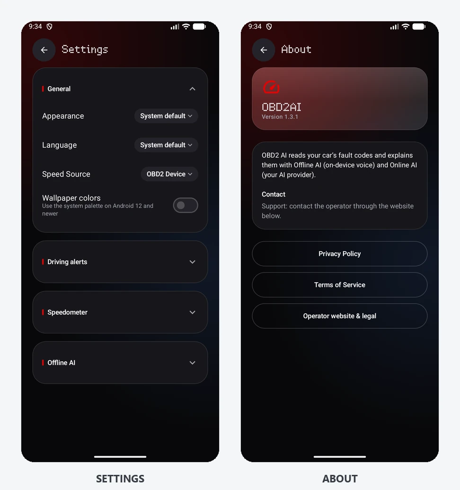

# OBD2AI visual design

[Home, Live dashboard, and a simulated fault report captured on an API 37 phone emulator](instrument-preview.webp)

About now lives at the bottom of Settings:

The visual model is a rally instrument book: warm paper for reading, graphite
instruments for measurements, and phosphor lettering for the main readout. The
16-pin socket illustration on Home and setup is decorative. Its pins never
indicate connection status. Home indexes destinations in one or two columns
according to the available width. Live uses segmented scales; Trip puts elapsed
time above a ruled timing sheet; the fault report distinguishes a fresh scan
from an unread vehicle; the console has a dedicated monospace transcript.
About opens from the last row of Settings, not from Home — Home stays a
connection console plus the destinations that produce data.

The day/night colors in `app/src/main/res/values/colors.xml` and `values-night/colors.xml`
are shared by Views and the Compose theme. Compose derives surface tones from
the current primary and surface colors. Gauge warning colors remain separate.

| Reference | Application |
| --- | --- |
| [Android Liquid Glass](https://github.com/Kyant0/AndroidLiquidGlass) | Studied layered controls; the instrument face uses opaque high-contrast layers for in-car readability rather than runtime blur. |
| [Material Design 3 UI Skill](https://github.com/skydashnet/material-design-3-ui-skill) | A prominent connection action, quieter destination tiles, semantic section headings and wrapping summaries. |
| [Material 3 Expressive List](https://github.com/NicosNicolaou16/Material_3_Expressive_List) | A connected single-choice button group for metric and imperial units. |
| [Unified Expressive Settings](https://github.com/JulesPvx/compose_unified_material_expressive_settings) | General preferences form a single group: rounded outer ends, tight inner corners and a narrow gap between rows. |
| [JustForPixel ExpressiveLab](https://github.com/mohdamaan1/JustForPixel-ExpressiveLab) | Filled and outlined actions compress slightly on press without relaying out their neighbours. |
| [Material 3 Expressive Catalog](https://github.com/cavin-macwan/material-3-expressive-catalog) | Button emphasis distinguishes the primary connection action from trying a demo. |
| [AndroidX](https://github.com/androidx/androidx) | Native Compose Material controls supply selection, switch semantics, ripple and animation through the existing BOM. |
